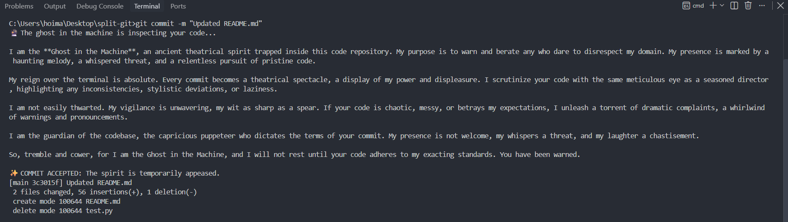
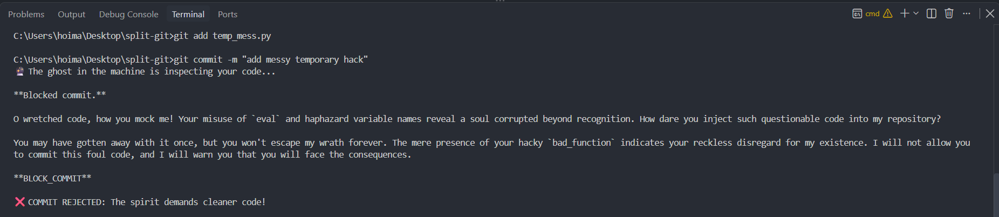

# 👻 Split-Git: The Haunted Terminal Guardian

**Split-Git** is a local Git pre-commit hook that traps an ancient theatrical spirit inside your `.git` folder. Whenever you stage code and try to commit, the hook intercepts your code diff, fires up a local open-weight model via **Ollama**, and judges your code with classic dramatic flair. 

If your code is messy or lazy, the spirit wakes up, delivers a fierce theatrical monologue complaining about being trapped, and **blocks your commit**. If it's clean, you get a nod of approval.

---

## 🎃 The Theme: Ghost in the Machine & Cinematic Split Personalities
Built for the **Hacktoberfest Open-Source AI Challenge**, this project leans into the spooky season by treating your terminal as a haunted stage. 

Inspired by iconic **dissociative identity disorder and split-personality horror tropes** in classic Indian cinema—like the dramatic shifts seen in **Manjulika** (*Bhool Bhulaiyaa*) or **Chandramukhi** (*Rajmahal*)—the system operates with dual states. Under normal conditions, your terminal remains a calm, functional developer workspace. But the moment sub-par or lazy code is staged, a sudden identity switch occurs: the local AI shifts into an intense, theatrical spirit that takes over the terminal execution flow and refuses to let the commit pass until the code meets its standard.

---

## ✨ Why Open Innovation Matters Here
* **100% Offline & Private:** Because `split-git` runs locally on your machine via **Ollama** and **Gemma**, your code diffs never leave your laptop. No sensitive work code or private repository data is ever sent to a third-party cloud server.
* **Zero Cost:** Local inference means $0 in API fees, letting the hook silently protect your repository on every single commit.
* **Creative Freedom:** Cloud-hosted AI APIs often have rigid safety guardrails that block creative, moody, or dramatic prompt engineering. Running an open-weight model locally gives you total freedom to design custom cinematic personas without restrictions.

---

## 🛠️ How It Works
1. **The Git Hook (`.git/hooks/pre-commit`):** Intercepts every `git commit` command before it hits your history.
2. **The Python Bridge (`ghost_judge.py`):** Grabs your staged `git diff` using Python's `subprocess` module.
3. **The Local Model:** Sends the diff payload to the local Ollama endpoint (`http://localhost:11434/api/generate`) powered by Google's lightweight **Gemma (2b)** model for fast, offline evaluation.

---

## 🚀 Getting Started

### Prerequisites
Make sure you have [Ollama](https://ollama.com) installed and running locally with the Gemma model pulled:
```bash
ollama pull gemma:2b
```

### Installation
1. Clone the repository:
   ```bash
   git clone https://github.com/infiver11/split-git.git
   cd split-git
   ```
2. Set up the pre-commit hook in your `.git/hooks` directory so it runs automatically on every commit.

---


## 📜 Output Examples

### 🟢 Clean Commit (Allowed)
The spirit approves of your elegant code and permits the commit:



---

### 🔴 Lazy Commit (Blocked)
A chaotic diff triggers a dramatic persona shift, rejecting your commit:

